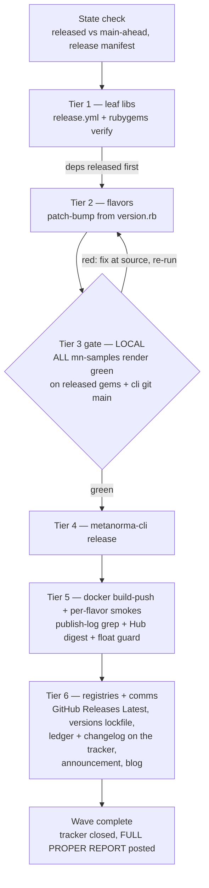
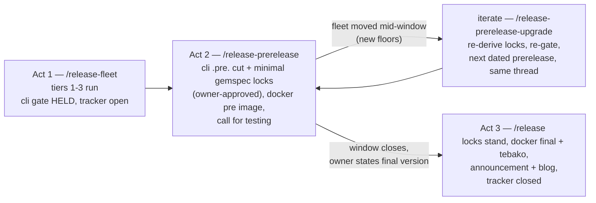

# metanorma/release-engineering

The metanorma release flow: documentation, gates, wave tracker, and tools.
Everything a maintainer (or an AI agent) needs to run a fully validated
release wave, from leaf gems to the Docker image, registries, and
communications.

## Install as a Claude Code plugin

This repo is also a Claude Code plugin and its own marketplace. Any
maintainer installs it with:

```
/plugin marketplace add metanorma/release-engineering
/plugin install metanorma-release@release-engineering
```

Skills (invoke as `/metanorma-release:<name>`, or bare `/release` when
unambiguous):

| Skill | Scope |
|---|---|
| `/release` | full validated release wave, tiers 1-6 (human-initiated only); also Act 3 (live) of the staged program |
| `/release-fleet` | Act 1 (stage): release tiers 1-3, HOLD the cli gate |
| `/release-prerelease <pre-version>` | Act 2 (test): cli prerelease + pre-release docker image + call for testing; end users compile their documents before anything goes live |
| `/release-prerelease-upgrade` | Act 2 iteration: fleet released new floors after the cut — re-derive the locks, re-gate, cut the next dated prerelease |
| `/release-smoke` | zero-side-effect dry run of the whole flow |
| `/samples-gate <repos…>` | Tier-3 local gate for one repo / one flavor |
| `/release-verify <version>` | post-release registries + artifacts sweep |
| `/wave-report v<prev> v<wave>` | ledger + changelog tracker comments |
| `/release-status` | read-only "where are we" state report |

### When to use what

| Situation | Use |
|---|---|
| The owner orders the next release wave and states the version | `/release <version>` |
| Release everything now but hold the cli gate — end users should test documents on a prerelease before the fleet goes live | the staged program: `/release-fleet` → `/release-prerelease <pre-version>` → `/release <final>` (recipe: `3-release-wave.md` § Staged release program) |
| The prerelease is out with testers, and the fleet just released new floors — the prerelease must catch up | `/release-prerelease-upgrade` (paste form: Prompt B of `9-prerelease-prompt.md`; a patch-only movement is a no-op and cuts nothing) |
| Prove the flow works before trusting it with a real wave, or after editing the docs | `/release-smoke [version]` |
| "Does this flavor render on the released stack?" — one repo, full gate evidence | `/samples-gate <repo>` (e.g. `/samples-gate iho`; several: `/samples-gate iso iho`; whole roster: `/samples-gate --full`) |
| A release just shipped and someone reports confusion about what is out | `/release-verify <version>` (e.g. `/release-verify 1.18.6`) |
| A wave is closing: the tracker needs its two standing comments | `/wave-report v<prev> v<wave> [tracker-url]` (e.g. `/wave-report v1.18.5 v1.18.6`) |
| "What would the next wave carry? Is anything blocking?" | `/release-status` |

Typical full cycle: `/release-status` to scope the wave →
`/release <version>` to run it → `/wave-report` at close-out →
`/release-verify` whenever anyone doubts what shipped. For the staged
program, three acts replace the single `/release`: `/release-fleet`
releases everything below cli and holds the gate →
`/release-prerelease <pre-version>` publishes the user-testable cli
prerelease — owner-stated version in the fleet's `.pre.` date form
(`<x>.<y>.<z>.pre.<yyyymmdd>`), rubygems opt-in install, docker pre
image, minimal gemspec locks derived from the validated fleet — with a
call for testing in metanorma/discussions (an invitation, not the
announcement) → `/release <final>` goes live, closes the tracker, and
posts the real announcement. Fleet movement mid-window is the
`/release-prerelease-upgrade` command: it re-derives the locks at the
new floors, re-runs the affected gates, and cuts the next dated
prerelease on the same testing thread. `/release-smoke` stands outside the cycle:
run it before the first real wave on this flow and after every
substantial edit to the docs or skills.

Standing rules in every skill:
- Version numbers are owner decisions. Patch = version.rb + 1; anything
  else waits for an explicit number, always.
- The skills never release gems owned by other orgs (relaton, fontist,
  glossarist, pubid, tebako slices) — they file requests there instead.
- Anything irreversible (tag deletion, force-pushes, dependency floors)
  stops and asks first.
- Nothing is reported as done without evidence; nothing is closed
  without verification.

`/release` additionally refuses to run without an explicit target
version, `/samples-gate` refuses a lone-flavor result while any tier-1
lib has unreleased main-ahead work (that combination does not predict
released behavior), and `/release-prerelease` brings the maintainer two
approval points before it posts anything: the derived gemspec lock plan
and the call-for-testing draft.

## How the flow fits together

A wave runs bottom-up; every gem's dependencies must already exist at
their released versions before the tier that needs them. Each arrow
into a gate is evidence-checked — green means verified, not assumed.
The wave tracker mirrors all of it as it happens.



The staged program splits one wave into three acts, holding the cli
gate so end users test real documents on a prerelease before the fleet
goes live. Act 2 can iterate as many times as the testing window
demands; Act 3 promotes instead of re-releasing.



Dependency direction in one line: tier-1 libs → flavors → the local
samples gate → cli (its gemspec locks `~>` the gate-validated minors)
→ docker → registries and communications. Nothing skips a gate, and
the prerelease channel is opt-in — live users never see a `.pre.`
version unless they ask for it.

## Start here (without the plugin)

**Copy/paste convention (all prompts, one rule):** clone
`metanorma/release-engineering` anywhere — the path is yours to choose.
Open the prompt doc you need (`7-release-prompt.md` for a full wave,
`8-smoke-test-prompt.md` for the dry run, `9-prerelease-prompt.md`
Prompts A/B for the prerelease acts), copy its fenced block into a
Claude Code session, replace `<RELEASE-PROCESS>` with your checkout
path, and fill the version argument. The prompt reads everything else
from that checkout — nothing is locked to any one machine.

1. Read the docs in order: `1-overview.md`, `2-pr-wave.md`,
   `3-release-wave.md`, `4-local-samples-validation.md`,
   `5-cli-docker-close-out.md`, `6-troubleshooting.md`.
2. Copy the fenced prompt in `7-release-prompt.md` and hand it to the AI
   agent with two inputs: the target metanorma-cli version (the owner's
   decision — patch bumps may follow version.rb; anything else waits for
   an explicit number) and where the tracker lives (metanorma/discussions
   by default).
3. The agent opens the wave tracker from `wave-tracker-template.md` at
   step 0 and keeps the mermaid stage classes and checkboxes in sync at
   every gate.
4. Deliverables: the FULL PROPER REPORT (defined at the end of the
   prompt), plus two tracker comments — `gem-ledger.rb` output (the
   all-gems version table diffed against the previous wave) and
   `gem-changelog.rb` output (per-gem changelog + wave summary, with a
   one-paragraph narrative written at close-out).

A release is not done until the registries and communications reflect it.
For the staged program (fleet first, user-testable prerelease, then
live), read `3-release-wave.md` § Staged release program — the same
gates apply act by act, with the cli gate held between acts. Act 2 has
two paste-ready prompts in `9-prerelease-prompt.md`: Prompt A cuts the
next prerelease, Prompt B upgrades an existing prerelease line to the
fleet's new floors.

## Tools

- `gem-ledger.rb v<prev> v<wave>` — version table for every Ribose-managed
  gem (per `GEM-OWNERSHIP.md`), diffed against the previous wave's frozen
  docker bundle and sorted changed-first: the changed/new/removed gems in
  one top table, everything unchanged collapsed behind a dropdown. Ends
  with a **Manifest drift** section (ownership changes: gems appear and
  disappear from the bundle) to apply before the wave closes.
  Prints ready-to-post markdown.
- `gem-changelog.rb v<prev> v<wave>` — per-gem changelog (GitHub Release
  notes when present, otherwise tag-compare subjects) plus a mechanical
  wave summary. Flags gems shipped to rubygems without their git tag.
  Prints ready-to-post markdown.
- Packed releases: `packed-metanorma/tools/sync-payload.rb` (tebako
  payload version sync; lives in the packed-metanorma repo).

## Pilot

`release-engineering#1` is the pilot tracker (the 1.18.6 wave, recorded
retroactively). The next real wave opens its tracker in
metanorma/discussions from `wave-tracker-template.md`.
