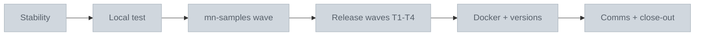

# Release wave tracker — TEMPLATE

Copy this into a NEW public Discussion in **metanorma/discussions**
(category: Announcements) at the start of every release wave, and edit the
Discussion body at each stage transition. The checkboxes mirror the oracles
(rubygems / CI runs / git tags) — never record state the oracles do not show.

## Title

`Release wave YYYY-MM-DD: <short name> (cli X.Y.Z)`

## Body template

````markdown
### Pipeline status



### Faces in this wave

| Gem | Tier | Target version | State |
|---|---|---|---|

### Tier 1 — leaf libs
- [ ] gem — vX.Y.Z on rubygems — GitHub Release

### Tier 2 — flavors
- [ ] metanorma-iso — vX.Y.Z — …

### Tier 3 — mn-samples local validation
- [ ] repo — bundle OK — forbidden-grep 0 — render OK — html count N

### Tier 4 — cli
- [ ] metanorma-cli vX.Y.Z

### Tier 5 — docker + registries
- [ ] release-tag dispatched
- [ ] publish log: Installing <gem> <version> for every bundled gem
- [ ] Hub digest moved
- [ ] metanorma/versions lockfile published

### Tier 6 — communications + close-out
- [ ] GitHub Releases verified (Latest marker on the new tag)
- [ ] metanorma/discussions announcement posted (link)
- [ ] metanorma.org blog post (link)
- [ ] reporter per-issue confirmations
- [ ] packed/tebako state recorded

### Version ledger

| Gem | Version | Released at | Notes |
|---|---|---|---|

### Ribose-managed gem versions (full ledger)

Every wave issue carries the resolved version of **all 95 Ribose-managed
gems** (per `GEM-OWNERSHIP.md`) — **as a diff against the previous wave's
frozen bundle**, sorted so the reader sees the wave first: a "Changed in
this wave" table (gem | org | version; new gems highlighted, dropped
gems struck through), then everything unchanged collapsed behind a
`<details>` dropdown with per-org tables inside. Generated by:

```
gem-ledger.rb v<prev-version> v<wave-version>
```

Post the script's output as one comment on the wave issue, marking nothing
by hand — the diff is the record. Gems absent from both bundles fall back
to their current rubygems version, noted as such.

### Per-gem changelog + wave summary

Second comment on the wave issue, generated by:

```
gem-changelog.rb v<prev-version> v<wave-version>
```

Mechanical extraction per changed gem: GitHub Release notes for the new
version when they exist, otherwise commit subjects from the two tags'
compare (capped at 8 lines per gem, source links carry the full list),
plus a mechanical wave summary (gems advanced, change count, busiest
gems). Write the one-paragraph wave narrative at close-out and post it
above the mechanical summary. A gem shipped to rubygems without its git
tag surfaces as a release-hygiene gap in the output — flag it.

### Reports
(per-document validation catalogs, PDF confirmations, container confirmations)
```

## Rules

1. Open the Discussion when the wave reaches `planned` (ancora) or the
   maintainer names the faces; edit the BODY at each transition — comments
   are for the final report and user questions.
2. The mermaid stage classes move pending → active → done as the gates pass.
3. Never check a box the oracle does not show; the tracker mirrors reality.
4. Cross-link: the GitHub Release of the cli cites the tracker; the tracker
   cites the announcement and blog post.
